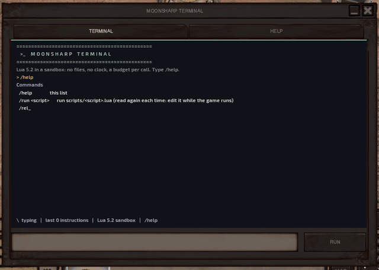
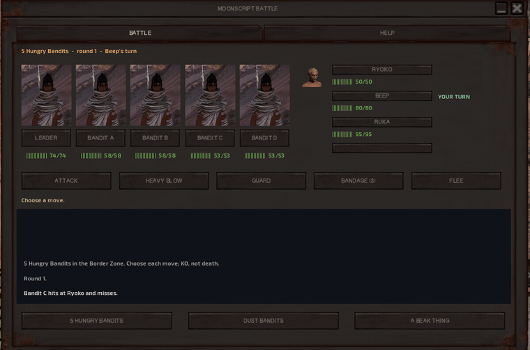

# MeitouMoonscript


> **Version 0.5.0** · Meitou `>=0.20.1` · ScriptHost API **1** · MoonSharp 3.0.0-beta.1 · Mod id `pza.moonscript`

| Hotkey / Command | What |
|---|---|
| **Shift+Y** | Open / close the Lua terminal (multi-line prompt continuation + `EDITOR` notepad tab; stands down while typing) |
| F10 > Mods | Terminal open/close, terminal demo, `/battle` (5 Hungry Bandits), `/crawlers` (Cat Crawlers) |
| `/battle [hungry\|dust\|beak]` | Animated 2D turn-based FF-style battle window (`scripts/fight.lua`) |
| `/crawlers` | Clickable Cat Crawlers bar game window (`scripts/crawlers.lua`) |
| `/packs`, `/start`, `/stop`, `/restart` | Discover and manage zero-C# Lua packs (built-in and `<OtherMod>/moonscript/<pack>/`) |
| `/allow <pack> [perm\|all]`, `/revoke <pack>` | Opt-in capability approval for third-party Lua packs |

By **PZA**. MeitouMoonscript is a shared, sandboxed **Lua 5.2 host** for Meitou code mods, built on [MoonSharp](https://github.com/moonsharp-devs/moonsharp), plus an **in-game terminal**, **zero-C# cross-mod Lua packs**, and built-in playable minigames.

Other modders can either:
1. Drop a zero-C# Lua pack into `<YourMod>/moonscript/<pack-id>/pack.json` + `main.lua`, or
2. Depend on `pza.moonscript` from C# (`IScriptHost` v1) to run isolated, deterministic Lua scripts with save/restore and hot reload.

See **[docs/MODDER-GUIDE.md](docs/MODDER-GUIDE.md)** for the full pack & API guide.



## Playable Minigames & Built-In Packs (0.3.0)



- **Turn-based Battle (`/battle`)**: Animated 2D FF-style battle stage with pixel-art sprites, squad portraits, health bars, action commands (`ATTACK`, `HEAVY BLOW`, `GUARD`, `BANDAGE`, `FLEE`), and live squad stat snapshots (`scripts/fight.lua`). KO only; nothing in your world changes.
- **Cat Crawlers (`/crawlers`)**: Clickable bar-game table (`FISH`, `ROLL BACK`, `TAKE`, `RIDE`, `DEAL`) powered by `scripts/crawlers.lua`.
- **Starter Lua Packs (`packs/`)**:
  - `wasteland-dice` — adds `/roll [NdS]` using the deterministic seeded RNG and `lib.fsm`.
  - `combat-ticker` — subscribes to narrow game events (`on("day")`, `on("hit")`, `on("character_down")`) and adds `/ticker` for a session combat summary.

## Zero-C# Lua Packs & Security Model

- **Cross-mod discovery**: Any Meitou mod can include `moonscript/<pack-id>/pack.json` + `main.lua`.
- **Opt-in permissions (`/allow`, `/revoke`)**: Third-party packs stay stopped until approved with `/allow <pack> all` (persisted in `packs.grants.json`). `PackHost` enforces least-privilege API exposure—only the capabilities declared and approved (`commands`, `timers`, `events`, `world.read`, `world.scan`, `world.control`, `pack.save`) are exposed to that pack.
- **World sensors, actuators & persistence (`0.4.0`)**: Opt-in `world.scan` (`world.characters`, `world.doors`, `world.buildings`), rate-limited `world.control` (max 16 actions/tick queued onto `World.Commands`: `doors.*`, `orders.*`, `world.floater`), and `pack.save` (C7-safe state persistence) enable pure-Lua base automation, raid alarms, and custom squad logic.
- **Camera, declarative HUD & C# extensions (`0.5.0`)**: Opt-in `camera.read` (`camera.yaw`, `camera.pitch`, `camera.pos`, `camera.forward`), click-through `ui.hud` overlays (auto-hide with `F7`, auto-cleanup on `/stop`), starter `/compass` pack, and `IPackExtensionHost.RegisterPackCapability(...)` so other C# Meitou mods can expose new opt-in Lua capabilities.

## Possibilities (What Modders Can Build)

With zero C# (just a `pack.json` + `main.lua`)—or paired with a C# extension mod—modders can build:

- **Outpost automation & perimeter defense**: automatically close/lock gates when hostiles approach, pop 3D floating alerts over buildings, or flip squad AI flags during raids (`world.scan`, `world.control`, `lib.fsm`).
- **Custom HUD overlays & navigation aids**: heading compasses, squad health/status strips, combat tickers, or day/clock widgets (`camera.read`, `ui.hud`, `on(...)`).
- **Tactical squad helpers**: automated rally/retreat orders, bodyguard/follow routines, or event-driven reactions to hits and knockdowns (`orders.*`, `on("hit")`, `on("character_down")`).
- **In-game minigames & puzzles**: dice/card tables, turn-based skirmishes, or 2D collision minigames with deterministic RNG and saved state (`lib.tween`, `lib.fsm`, `lib.bump`, `pack.save`).
- **C#-backed Lua frameworks**: any C# Meitou mod can plug new opt-in capabilities into `PackHost` via `IPackExtensionHost` so pure-Lua packs can safely drive custom engine features.
- **Hardened isolation**:
  - Symlinks/junctions and path escapes (`..`) are rejected by `SafePath`.
  - Reserved terminal commands cannot be shadowed; colliding pack commands are namespaced as `/<pack-id>:<cmd>`.
  - Narrow allow-listed game events only (`day`, `hour`, `hit`, `character_down`).
  - Global per-frame instruction ceiling (`800,000` instructions across all packs combined) plus per-call budgets.
- **Vetted pure-Lua stdlib (`lib`)**: `lib.tween` (22 easings), `lib.fsm` (plain-data C7-safe state machines), and `lib.bump` (2D swept AABB collision world).

## What a Script Gets, and What It Never Gets

- Lua 5.2: `string`, `table`, `math`, `bit32`, `coroutine`, `pcall` / `error`, metatables, `lib.*`, plus whatever the calling mod hands it.
- **No** files, `os`, `io`, `load` / `require` / `dofile`, `debug`, `collectgarbage`, `string.dump`, platform facts or wall clock. `math.random` is a deterministic seeded SplitMix64 generator saved with the script.
- **Hard budgets & caps**: instruction budgets per call and per tick (counted across coroutines and callbacks), allocation/live-size caps, and a call-depth cap on a dedicated 16 MB Lua thread. A faulting script is cleanly disabled for that world with one log line; the game goes on.

All sandbox and determinism claims (C1–C8, B1–B6) are verified by the automated Euler suite and 16 fuzz targets: see [tools/euler/CLAIMS.md](tools/euler/CLAIMS.md).

## ScriptHost API (version 1)

```json
"dependencies": [{ "id": "pza.moonscript", "version": ">=0.3.0" }]
```

Reference `MeitouMoonscript.dll` with `Private="false"`. MoonSharp stays private to this mod; only plain `ScriptValue` data crosses the boundary.

```csharp
var host = context.Dependency<IScriptHost>("pza.moonscript")!;            // in Initialize; host.ApiVersion == 1
var s = host.Open(new ScriptSpec
{
    Owner = "my.mod", Name = "ladder", Folder = context.Folder, File = "scripts/ladder.lua",
    Seed = seedFromYourWorldRng,                                          // never the clock
    Functions = [new HostFunction("game", "stake", args => ScriptValue.Of(args[0].Number * 2))],
});
s.BeginTick(world.Tick);                                                  // before a tick's calls
var r = s.Call("choose", ScriptValue.Of(3));                              // plain values in and out
// your IModSaveData: s.Save() / s.Restore(bytes);  your IStateHashed: s.StateHash()
if (s.Fault is { } why) context.Log($"ladder switched off: {why}");
```

- v1 members are never removed or changed; future additions raise `ApiVersion`.

## Build and Check

```powershell
.\mod\build.ps1            # build and stage mod\out\MeitouMoonscript
.\mod\build.ps1 -Check     # offline check + Euler suite + 16 fuzz targets (never starts the game)
```

## Known Limits

- The terminal shows the newest 22 lines (no scrollback history yet).
- `memory-hard` (64 MB allocated in one call) is a safety net; the deterministic caps fire first.
- Data hidden in a suspended coroutine is counted via MoonSharp 3.0.0-beta.1 internals.

## Credits and Licence

**PZA**, GPLv3 or later (`LICENSE`). MoonSharp by Marco Mastropaolo and contributors, BSD 3-Clause, shipped unmodified (`NOTICE.md`).
Windows built on PZA's Meitou UI. Unofficial fan-made mod; not affiliated with Lo-Fi Games or the Meitou project.
